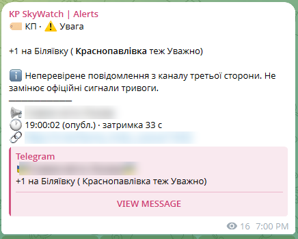

# Skywatch

[](https://github.com/koliesnikyevhenii/koleso-skywatch/actions/workflows/ci.yml)


**Real-time Telegram mention monitor for one village.** Skywatch reads busy regional Telegram channels, picks out the few posts that mention a specific village, removes duplicates, and delivers each unique mention to a private channel within seconds, with a clear disclaimer.

<p align="center">
  
  <br>
  <sub>A real alert. The village name is in bold, delivered 33 s after the source published it. Source details are blurred.</sub>
</p>

---

## The problem

In front-line regions of Ukraine, people follow many Telegram channels that post real-time air-threat reports for the whole region. Mentions of your own village are buried in hundreds of messages a day about other places, and the same report is reposted across several channels. You either read everything, or you miss what matters to you.

Skywatch is built for one village, **Krasnopavlivka** (Kharkiv oblast). It does the reading for you and posts only the mentions of that village, once each.

## What it does

- 📡 **Listens in real time** to an allowlist of channels and groups through a Telegram *user* account (MTProto push updates, no polling).
- 🔤 **Understands how people actually write the name**: every Ukrainian and Russian case form, adjectives, hashtags, hyphenated spellings, the abbreviation `КП` after a preposition (but not `КП "Водоканал"`), and the local colloquial name.
- 🧹 **Removes duplicates**: forwards of the same original post, and identical text reposted by other channels.
- ⏱️ **Drops stale news.** A match older than 120 s is not sent as an alert. A summary such as "N stale matches skipped" is posted instead.
- 🔔 **Delivers through a bot** to one private channel or group. Mentions are shown in bold, followed by the source, publish time, delivery delay and a link to the original.
- ↪️ **Relays follow-ups**: when a source replies to a post that was already alerted ("no longer detected"), the reply is forwarded verbatim as a reply to the alert.
- ✏️ **Handles edits**: a post that is edited to mention the village is alerted and marked `✏️ оновлено`.
- ✅ **Measures itself.** Readers label each alert `useful / false / duplicate` with inline buttons. A daily report gives volumes, precision per pattern, duplicates, latency p50/p95 and connection stability.

## Why it matters

| Without Skywatch | With Skywatch |
|---|---|
| Scroll through several channels and hundreds of posts | One quiet group with only the relevant posts |
| The same report arrives 3–5 times | Each mention is delivered once |
| Late reposts look like new events | Anything older than 2 minutes is held back and summarised |
| No way to know if a filter is any good | Precision, misses and latency are measured daily |

It is an experiment by design. The first goal is to **measure** whether this kind of filter is precise and fast enough to be useful. The measurements cover precision, noise, duplicate rate and end-to-end latency (target p95 ≤ 5 s) over a 3–7 day run. Any wider use is a separate decision.

## Safety by design

Hard constraints from the [specification](docs/spec.md#2-hard-constraints) that the code enforces:

- **Mentions only.** No coordinates, trajectories, movement mapping or military-position logic. Follow-ups are relayed verbatim and never interpreted.
- **One private target.** The bot sends only to the configured private channel or group. There is no public broadcasting.
- **Every alert carries a disclaimer**: unverified third-party information, not a replacement for official air-raid alerts.
- **No secrets in git, no secrets in logs.** The repository is public. Secrets come from User Secrets or environment variables, a log filter masks them, and gitleaks runs on every commit and in CI.
- **Careful with the Telegram account**: one process per session (file lock), backoff on `FLOOD_WAIT`, and no reconnect loop after the session is rejected.

## How it works

```mermaid
flowchart LR
    S["Allowlisted channels<br/>and groups"] -->|MTProto updates| R["Reader account<br/>(WTelegramClient)"]
    R --> Q[["Bounded channel<br/>(1000)"]]
    Q --> N["Normalize<br/>NFKC, zero-width, ё→е"]
    N --> M["Match named<br/>regex patterns"]
    M --> D["Deduplicate<br/>origin key + SHA-256"]
    D --> DB[("SQLite<br/>message + Pending<br/>notification")]
    DB --> O["Outbox dispatcher<br/>staleness re-check,<br/>429 / retry / backoff"]
    O -->|Bot API| G["Private channel"]
    G -->|label buttons| L["Labels"]
    L --> DR["Daily report<br/>precision, latency"]
```



1. **Receive.** The update handler only maps the Telegram object to an internal record and puts it in a bounded channel. It never blocks the MTProto client.
2. **Normalize and match.** Pure functions in `Skywatch.Core` clean the text and run named, configurable regex patterns, compiled with a 100 ms timeout.
3. **Persist with an outbox.** The message row and its `Pending` notification are written in one transaction. A crash can therefore lose neither, and a restart re-queues what was not sent.
4. **Deliver.** A single dispatcher sends notifications in order. It re-checks staleness before every attempt, honours `429 retry_after`, retries network errors with backoff and flags possible duplicates on timeouts.
5. **Catch up.** After a reconnect or restart, the saved update state replays missed messages through the same pipeline.
6. **Report and retain.** A daily report is posted at 09:00 Kyiv time, DST-aware. A retention job removes message text after a few days and metadata after 30 days.

## Engineering highlights

- **.NET 10 Worker Service**: `BackgroundService`, built-in DI, Options pattern validated on start, `TimeProvider` everywhere.
- **Clean split**: `Skywatch.Core` holds the pure logic (normalizer, filter, hashing, formatting, time rules) and has no package references and no IO. Telegram types never leave a single mapping layer.
- **EF Core + SQLite** with migrations, unique indexes for idempotency, UTC converters and a fresh `DbContext` per unit of work through `IDbContextFactory`.
- **Spec-driven development.** Every acceptance criterion in [`docs/spec.md`](docs/spec.md) has an ID, and tests are named after it, e.g. `AC_F5_3_abbreviation_after_preposition_matches`.
- **550+ tests** with xUnit v3 and Shouldly. They use SQLite in-memory (real unique indexes), `FakeTimeProvider` instead of delays, and hand-written fakes for the two Telegram seams. Every new false positive or missed form becomes a theory row.
- **One verification gate** for local runs and CI (`build/verify.ps1`): restore, build with warnings as errors, test, `dotnet format`, and gitleaks over staged changes and full history.
- **Production-minded ops**: multi-stage Docker image running as non-root, a named volume for session and database, graceful shutdown with drain, JSON logs with rotation, and a written runbook.

## Tech stack

| Area | Choice |
|---|---|
| Runtime | .NET 10, C# (nullable, warnings as errors, Central Package Management) |
| Telegram | [WTelegramClient](https://github.com/wiz0u/WTelegramClient) for MTProto as a user account; [Telegram.Bot](https://github.com/TelegramBots/Telegram.Bot) for delivery and buttons |
| Storage | EF Core, SQLite |
| Tests | xUnit v3, Shouldly, Microsoft.Testing.Platform, `FakeTimeProvider` |
| Delivery | Docker, Docker Compose on a Linux VPS; Windows Service as an alternative |
| CI / security | GitHub Actions, gitleaks with custom rules, GitHub secret scanning |

## Project structure

```text
src/
  Skywatch.Core/        Pure logic: Normalization, Filtering, Deduplication, Formatting, Time
  Skywatch.Worker/      Host: Telegram/, Pipeline/, Persistence/, Hosting/, Options/
tests/
  Skywatch.Core.Tests/
  Skywatch.Worker.Tests/
deploy/                 docker-compose.yml, .env.example, runbook
docs/                   spec.md (source of truth), plans/
build/                  verify.ps1, git hooks
```

## Getting started

You need the .NET 10 SDK, a Telegram account with an `api_id` / `api_hash` from [my.telegram.org](https://my.telegram.org), a bot from @BotFather and a private channel or group (in a channel, make the bot an admin that can post).

```powershell
powershell -NoProfile -File build/verify.ps1          # build + tests + format + secret scan
dotnet user-secrets set "Telegram:ApiId" "<id>" --project src/Skywatch.Worker   # and the other secrets
dotnet run --project src/Skywatch.Worker -- login       # interactive first login
dotnet run --project src/Skywatch.Worker -- list-chats  # find chat ids for Monitoring:Sources
dotnet run --project src/Skywatch.Worker                # run
```

On a server:

```sh
cd deploy && cp .env.example .env    # fill in, chmod 600
docker compose run --rm skywatch login
docker compose up -d
```

The full configuration reference is in [spec §6](docs/spec.md#6-configuration-reference), and VPS setup, backups and incident handling are in [`deploy/README.md`](deploy/README.md).

## Status

An MVP running as a time-boxed experiment. It posts only to a private, invite-only channel and is not an official alert service. Always follow official air-raid alerts.

## License

[MIT](LICENSE) © 2026 Yevhenii Koliesnik
